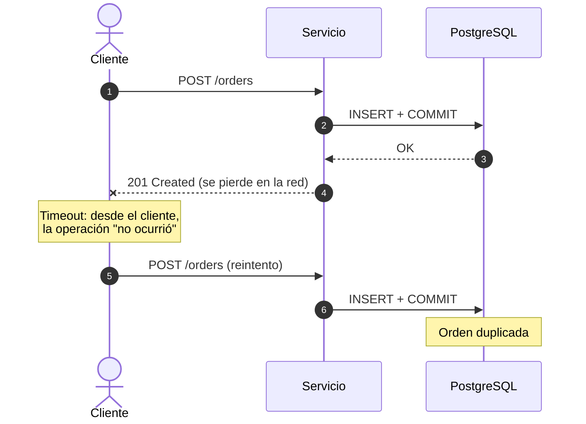
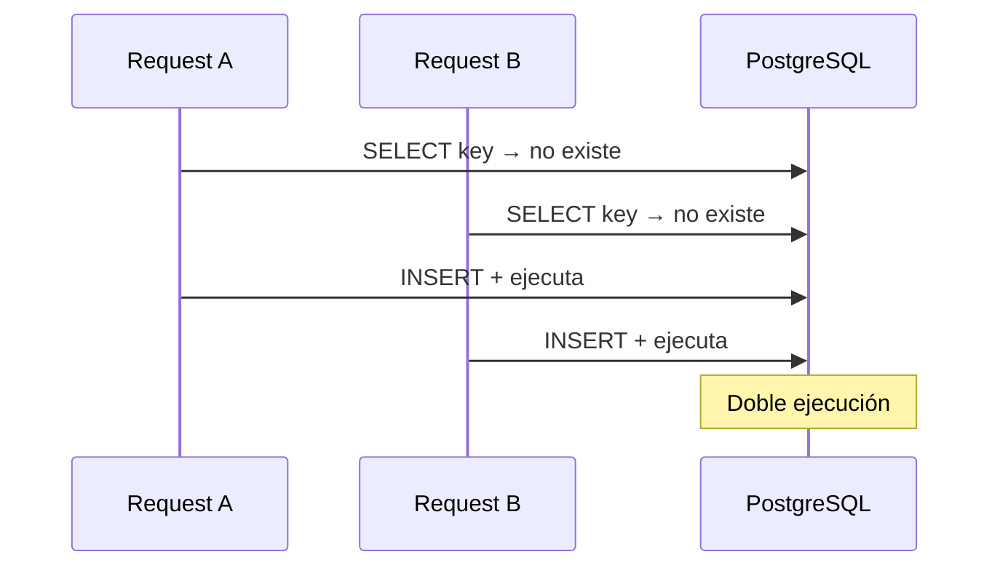
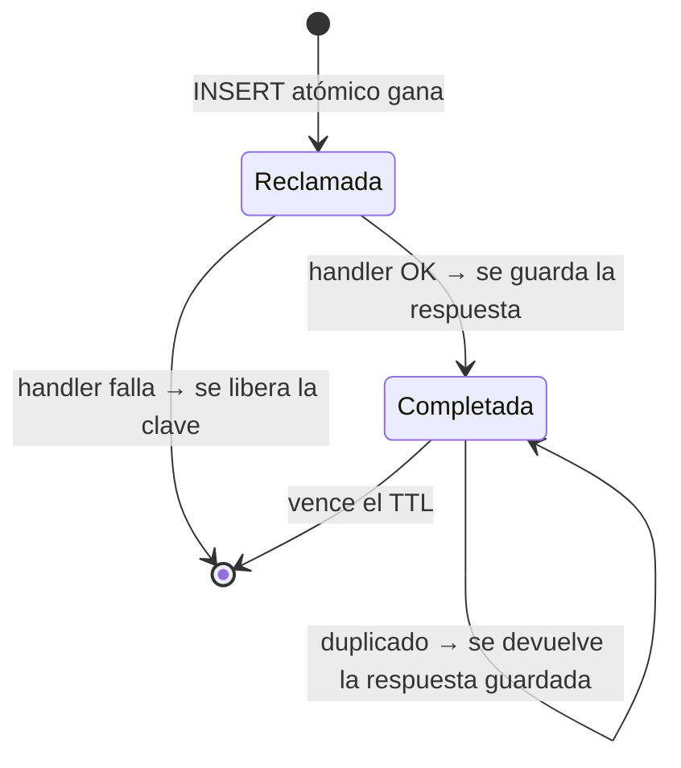
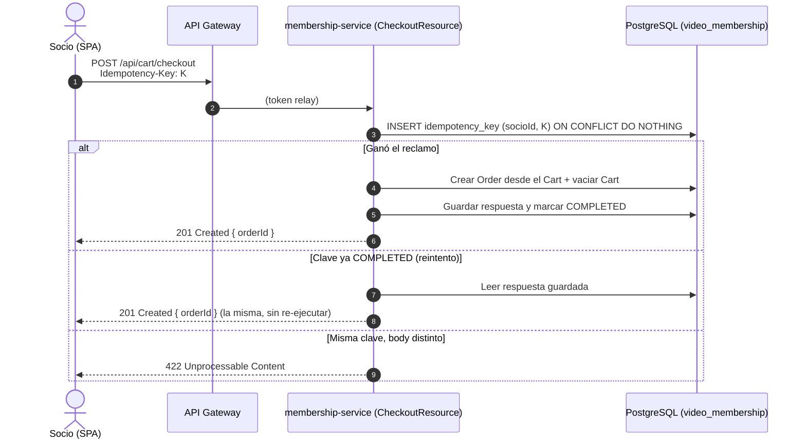

# Idempotencia en Endpoints REST: Concepto y Aplicación al Carrito de Compras

> [!NOTE]
> **Estado: nota de diseño y material de clase.** Nada de lo descripto acá está implementado todavía. El documento separa primero **qué problema resuelve** la idempotencia y después **cómo aplicaría** al carrito de `membership-service` descripto en el [plan de carrito con ECST](plan/plan-carrito-ecst-rabbitmq.md).

## Referencias

* **Artículo base:** [One Annotation to Make Spring Boot REST Endpoints Idempotent](https://medium.com/heap-wire/one-annotation-to-make-spring-boot-rest-endpoints-idempotent-6345e72d1e3c) (Medium, *heap-wire*) · [versión sin paywall](https://freedium-mirror.cfd/https://medium.com/heap-wire/one-annotation-to-make-spring-boot-rest-endpoints-idempotent-6345e72d1e3c).
  Presenta el starter `idempotency-spring-boot-starter` (anotación `@Idempotent`, header `Idempotency-Key`, stores en memoria, Redis y JDBC/Postgres).
* **Semántica HTTP:** [RFC 9110, §9.2.2 — Idempotent Methods](https://www.rfc-editor.org/rfc/rfc9110#section-9.2.2).
* **Borrador IETF del header:** [The Idempotency-Key HTTP Header Field](https://datatracker.ietf.org/doc/draft-ietf-httpapi-idempotency-key-header/).

> [!IMPORTANT]
> Los nombres exactos de propiedades y la matriz de compatibilidad del starter deben verificarse en su README antes de usarlo. Este documento describe el **comportamiento**, no la configuración literal.

---

## Parte 1 — Lo conceptual: qué problema resuelve

### 1.1. El problema: el commit ocurrió, la respuesta se perdió



Desde el punto de vista del cliente, reintentar es **correcto**: no tiene forma de distinguir "el servidor no recibió el pedido" de "el servidor lo procesó pero la respuesta no volvió". El mismo modo de falla aparece con:

* timeouts del cliente o de un proxy (el API Gateway incluido),
* doble click en un botón,
* reconexiones de red móvil,
* reintentos automáticos de librerías HTTP.

**La red no puede garantizar entrega exactamente una vez.** Por lo tanto, quien recibe tiene que tolerar recibir lo mismo más de una vez.

### 1.2. Qué significa "idempotente"

Una operación es idempotente si ejecutarla N veces deja el sistema en el **mismo estado** que ejecutarla una vez. HTTP ya define cuáles métodos lo son por contrato (RFC 9110):

| Método | ¿Idempotente? | Ejemplo |
| :--- | :--- | :--- |
| `GET` | Sí | Leer el carrito. |
| `PUT` | Sí | "La cantidad de la película 10 es 2". |
| `DELETE` | Sí | Quitar la película 10 del carrito. |
| `POST` | **No** | "Creá una orden", "sumá 2 unidades". |

> [!TIP]
> **La solución más barata es de diseño, no de infraestructura.** Si una operación puede expresarse como "fijar un estado" (`PUT`) en lugar de "aplicar un cambio" (`POST`), el problema desaparece sin agregar nada. La clave de idempotencia es para lo que **no** puede reformularse así: crear recursos nuevos o disparar efectos externos (cobros, emails).

### 1.3. `Idempotency-Key`: el cliente identifica la operación lógica

El servidor no puede adivinar qué reintento corresponde a qué pedido original. **El cliente tiene que decírselo**: genera un identificador único (típicamente un UUID) por *operación lógica* y lo reenvía idéntico en cada reintento.

```http
POST /api/cart/checkout
Authorization: Bearer <jwt>
Idempotency-Key: 7f3c2a9e-1b4d-4c8e-9f21-0a6b5d3e8c11
Content-Type: application/json
```

* Misma clave → mismo pedido lógico (reintento).
* Clave distinta → operación nueva, aunque el body sea idéntico.

Esa cadena pasa a ser **parte del contrato de la API** y tiene que documentarse como tal.

### 1.4. El reclamo atómico (y por qué `find()` + `save()` está mal)

La implementación ingenua es:

```java
if (repo.findByKey(key).isPresent()) {
    return storedResponse(key);
}
repo.save(new IdempotencyRecord(key));
return execute();
```

Tiene una carrera: dos requests simultáneas con la misma clave ejecutan el `find()`, las dos ven "no existe", y las dos ejecutan la operación.



La decisión de quién es dueño de la clave tiene que ser **una sola operación atómica** en el store:

| Store | Reclamo atómico |
| :--- | :--- |
| PostgreSQL | `INSERT ... ON CONFLICT DO NOTHING` (afectó 1 fila → ganaste; 0 → ya existía) |
| Redis | `SET key value NX` (`SETNX`) |

Por eso la idempotencia no es "un cache de respuestas": es un **protocolo de concurrencia**.

### 1.5. La máquina de estados



Casos que la API tiene que definir explícitamente:

| Situación | Comportamiento esperado |
| :--- | :--- |
| Primera request con la clave | Se ejecuta y se guarda la respuesta. |
| Duplicado con la operación ya completada | Se devuelve la respuesta guardada **sin ejecutar** el handler. |
| Duplicado mientras la original sigue en curso | Esperar (`wait`) o rechazar de inmediato (`fail_fast`). El borrador IETF sugiere `409 Conflict`. |
| Misma clave, **body distinto** | Rechazo (`422`). Se detecta comparando una *huella* (fingerprint) del request. |
| Request sin clave en un endpoint que la exige | Rechazo (`400`) en lugar de ejecutar sin protección. |

### 1.6. Garantías: *at-least-once* vs. *exactly-once*

El servidor coordina **dos efectos**: la operación de negocio y el registro "completada". Si no comparten la transacción, queda una ventana:

```text
COMMIT de la orden ──► [ el proceso muere acá ] ──► guardar "completada"
```

Un reintento posterior ve la clave sin completar y vuelve a ejecutar. Eso es **at-least-once**, y el artículo lo documenta con honestidad para el store de Redis y para el modo JDBC por defecto.

Con JDBC hay una opción más fuerte: *transaction joining*. El reclamo, la operación de negocio y la marca de completada se confirman en **un único COMMIT**. Si algo falla, todo hace rollback y el reintento vuelve a empezar limpio. Eso es **exactly-once** dentro de la base.

> [!WARNING]
> **Exactly-once no es una mejora gratuita.** Con transaction joining, el handler retiene una conexión del pool durante toda la transacción. Si el handler tarda 500 ms porque llama a un servicio externo, el pool (Hikari: 10 conexiones por defecto) pasa a ser el límite de concurrencia del endpoint. Además, `REQUIRES_NEW` queda fuera de la transacción compartida y los timeouts a nivel método no sobrescriben el de la transacción exterior. Es una decisión de arquitectura, no un checkbox.

Es la misma brecha que ya aparece en este proyecto con `@TransactionalEventListener(AFTER_COMMIT)`: entre el COMMIT y la publicación a RabbitMQ también hay una ventana donde el proceso puede morir.

### 1.7. Scope: la clave no es global

Dos usuarios distintos pueden generar la misma clave (un cliente mal implementado, un valor fijo de prueba). Si el espacio de claves es global, **el pedido de uno se trata como reintento del otro y recibe la respuesta ajena**. La identidad real de la operación tiene que ser:

```text
(usuario autenticado, Idempotency-Key)
```

y no solo `Idempotency-Key`. Esto es un tema de **seguridad**, no un detalle.

### 1.8. Propagar la clave a proveedores externos

Si la operación llama a un proveedor externo (por ejemplo, un procesador de pagos), el servicio también puede hacer timeout contra él. Si el proveedor acepta claves de idempotencia, se le pasa **la misma clave lógica**: así la operación queda protegida en ambos bordes.

### 1.9. Por qué es una preocupación transversal

Implementar esto en cada controller convierte a cada uno en "una mini librería de sistemas distribuidos". El starter del artículo lo resuelve con **Spring AOP**: el aspecto intercepta el método anotado con los argumentos ya deserializados (lo que permite calcular el fingerprint sin re-leer el stream del request) y delega en una SPI `IdempotencyStore` intercambiable. El controller y el servicio de negocio no saben nada de idempotencia.

---

## Parte 2 — Aplicación al proyecto: el carrito en `membership-service`

### 2.1. Mapa de endpoints

| Endpoint (plan actual) | ¿Necesita `Idempotency-Key`? | Motivo |
| :--- | :--- | :--- |
| `GET /api/cart` | No | Lectura. |
| `DELETE /api/cart/items/{movieId}` | No | Idempotente por semántica HTTP. |
| `POST /api/cart/items { movieId, quantity }` | **Depende** | Ver §2.2. |
| `POST /api/cart/checkout` *(no está en el plan)* | **Sí** | Crea un recurso nuevo y eventualmente dispara un cobro. Es exactamente el caso del artículo. |

### 2.2. Primero, corregir el contrato de "agregar ítem"

El plan dice que `POST /api/cart/items` "agrega o actualiza ítems". Eso es ambiguo:

* **Si incrementa** ("sumá 2"): un doble click deja 4 unidades. Necesitaría idempotencia.
* **Si fija la cantidad** ("la cantidad es 2"): es idempotente por diseño.

**Propuesta:** modelarlo como fijar estado.

```http
PUT /api/cart/items/{movieId}
Content-Type: application/json

{ "quantity": 2 }
```

Con este cambio, todas las operaciones de edición del carrito quedan idempotentes **sin infraestructura adicional**. El precio sigue tomándose de `movie_projection`, como define el plan.

### 2.3. Checkout: donde la idempotencia sí hace falta



Decisiones propuestas para este endpoint:

1. **Store JDBC sobre `video_membership`.** El proyecto ya usa PostgreSQL y no tiene Redis. El reclamo de la clave y la creación de la orden viven en la misma base, lo que habilita la garantía fuerte.
2. **Clave obligatoria.** Sin `Idempotency-Key`, `400`. Un checkout nunca debería ejecutarse sin protección.
3. **Scope por socio.** La identidad es `(socioId del JWT, Idempotency-Key)`. Nunca la clave sola (§1.7).
4. **Transaction joining: a decidir con un ADR.** Mientras el checkout solo escriba en PostgreSQL, el costo sobre el pool es bajo y la ganancia (exactly-once) es alta. Si en el futuro se integra un proveedor de pagos externo, hay que reevaluar (§1.6).
5. **Generación de la clave en la SPA.** `react-sso` genera un UUID al **abrir** la confirmación del checkout (no en cada click) y lo reusa en todos los reintentos de esa confirmación.
6. **Gateway transparente.** El API Gateway tiene que reenviar el header `Idempotency-Key` sin modificarlo, y si se configuran reintentos en el Gateway, ese header es lo que los vuelve seguros.

### 2.4. Dos idempotencias distintas en el mismo sistema

El proyecto ya resuelve un caso de idempotencia; vale la pena mostrarlos juntos en clase:

| | Idempotencia de mensajería | Idempotencia HTTP |
| :--- | :--- | :--- |
| Dónde | Consumidor `@RabbitListener` | Endpoint REST |
| Qué se repite | Redelivery del broker | Reintento del cliente |
| Mecanismo | Upsert en `movie_projection` / consumidor idempotente de socios | `Idempotency-Key` + reclamo atómico |
| Quién identifica el duplicado | El propio payload (ID de la película o del socio) | El cliente, con la clave |

**Es el mismo principio:** algo puede llegar más de una vez y la responsabilidad de tolerarlo es del lado que recibe.

### 2.5. Implementar a mano o usar el starter

Para un taller, la recomendación es **en dos pasos**:

1. **Implementación mínima a mano**, para que el concepto quede a la vista:

   ```sql
   CREATE TABLE idempotency_key (
       socio_id       BIGINT       NOT NULL,
       idem_key       VARCHAR(255) NOT NULL,
       request_hash   VARCHAR(64)  NOT NULL,
       status         VARCHAR(16)  NOT NULL,  -- IN_PROGRESS | COMPLETED
       response_code  INT,
       response_body  TEXT,
       created_at     TIMESTAMP    NOT NULL,
       PRIMARY KEY (socio_id, idem_key)
   );
   ```

   El flujo: `INSERT ... ON CONFLICT DO NOTHING`; si afectó una fila se ejecuta y se completa; si no, se compara `request_hash` (`422` si difiere) y se devuelve la respuesta guardada.

2. **Después, mostrar el starter** como "esto es lo que la abstracción hace por vos": la misma lógica detrás de `@Idempotent`, con stores intercambiables, políticas configurables y las garantías documentadas.

### 2.6. Checklist antes de adoptar el starter

* [ ] Verificar la matriz de compatibilidad (el artículo indica la línea `0.2.0` para Java 17+ y Spring Boot 4.1.x; el proyecto usa Spring Boot `4.1.1`).
* [ ] Evaluar la madurez de una dependencia `0.x` de terceros en el camino crítico del checkout.
* [ ] Confirmar la política ante caída del store (fallar cerrado en checkout).
* [ ] Definir el TTL de las claves y la limpieza de la tabla.
* [ ] Configurar el scope por usuario autenticado.
* [ ] Documentar el header `Idempotency-Key` en el contrato de la API (OpenAPI).

---

## Decisiones abiertas

| # | Decisión | Opciones |
| :--- | :--- | :--- |
| D1 | Semántica de agregar ítem al carrito | `POST` incremental con clave vs. **`PUT` fijando cantidad** (propuesto) |
| D2 | Alcance del carrito | Agregar o no la fase de checkout/orden al [plan](plan/plan-carrito-ecst-rabbitmq.md) |
| D3 | Implementación | A mano vs. starter vs. ambas en secuencia (propuesto) |
| D4 | Garantía del checkout | At-least-once vs. exactly-once con transaction joining (requiere ADR) |
